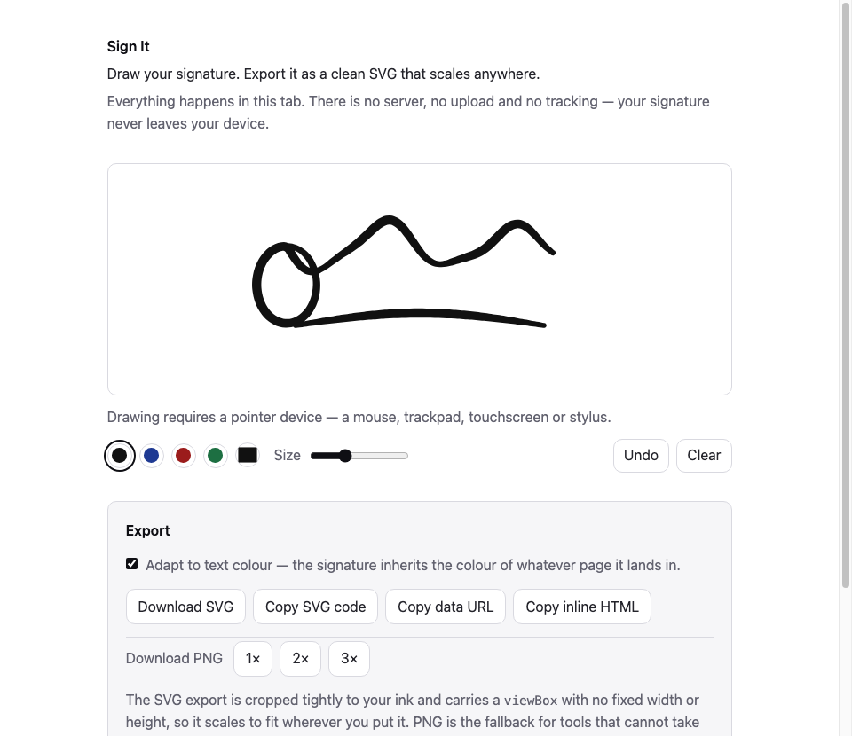

# Sign It

Draw a handwritten signature with a mouse, finger or stylus and export it as a clean, tightly-cropped SVG — entirely in your browser.



**[Live demo](https://YOUR-USERNAME.github.io/sign-it/)**

## How it works

Pointer events are sampled as you draw — including pressure from a stylus and the full sample rate from `getCoalescedEvents()` — and handed to [perfect-freehand](https://github.com/steveruizok/perfect-freehand), which turns each list of points into a closed outline polygon that tapers with speed and pressure. That outline is rendered as a filled `<path>` inside an `<svg>`, so there is never a raster step and the export is lossless. On export, the bounding box of the rendered ink becomes the `viewBox`, which is why the resulting file is cropped to the signature instead of the pad.

## Privacy

There is no backend, no API and no third-party service. Nothing you draw is uploaded, stored or measured: the page makes **zero network requests** while you draw and export, sets no cookies, and writes nothing to `localStorage`. After the first load it works fully offline — `perfect-freehand` is vendored into `vendor/` rather than pulled from a CDN. You can verify all of this with the Network tab open.

## Using it

Clone the repo and open `index.html`. There is no build step, no `package.json` and no dependencies to install. It deploys to GitHub Pages straight from the default branch root with no configuration.

## Embedding it in your own page

The page is a thin wrapper around one ES module, so you can drop the pad into any site:

```html
<link rel="stylesheet" href="src/signature-pad.css">
<div id="pad"></div>

<script type="module">
  import { mountSignaturePad } from './src/signature-pad.js';

  const pad = mountSignaturePad('#pad', {
    color: '#1f3a93',
    size: 10,
    onChange: (svg) => console.log(svg.length, 'bytes of signature'),
  });
</script>
```

### Options

| Option | Type | Default | Meaning |
|---|---|---|---|
| `color` | string | `#111111` | Initial ink colour |
| `size` | number | `8` | Initial stroke size |
| `background` | string | `transparent` | Pad background |
| `showControls` | boolean | `true` | Render the built-in control bar |
| `onChange` | function | — | Called with the current SVG string on every change |

### The handle

`mountSignaturePad` returns a handle, so you can drive the pad from your own UI with `showControls: false`:

```js
const pad = mountSignaturePad('#pad', { showControls: false });

pad.undo();                          // remove the last stroke
pad.clear();                         // remove everything
pad.isEmpty();                       // boolean
pad.strokeCount;                     // number of committed strokes

pad.toSVG();                         // "<svg …>" with literal colours
pad.toSVG({ currentColor: true });   // fills become currentColor
pad.toDataURL();                     // "data:image/svg+xml,…" (same options)
pad.toPNG(2);                        // Promise<Blob>, at 2× the ink size

pad.setColor('#b91c1c');
pad.setSize(12);
pad.destroy();                       // unbind listeners and empty the host
```

Undo is also wired to `Cmd/Ctrl+Z`.

### Theming

The component's colours all read shared custom properties, each with a sensible fallback, so it picks up a host site's theme when that site defines them: `--bg-primary`, `--bg-secondary`, `--text-primary`, `--text-strong`, `--text-secondary`, `--border-color`, `--radius`.

The built-in control bar covers drawing — colour, size, undo, clear. Export buttons belong to the host page: the standalone demo builds its own from the handle, and `src/app.js` is a short, readable example of doing exactly that.

### `currentColor` and dark themes

`toSVG({ currentColor: true })` emits `fill="currentColor"` instead of a literal hex. Paste that markup inline into a page and the signature inherits the surrounding text colour, so it works in both light and dark themes without a second copy:

```html
<p style="color: #b91c1c">
  Signed, <svg xmlns="http://www.w3.org/2000/svg" viewBox="…" style="height:2em;vertical-align:middle">…</svg>
</p>
```

This is the useful mode for a signature in a page footer. Downloaded `.svg` files keep literal colours instead, since a standalone file has no surrounding text to inherit from, and PNG always bakes the literal colour because `currentColor` means nothing in a raster image.

## What this is not

This produces an **image of a signature, not a legal signature**. It does not sign documents, verify identity, or create an audit trail, and it makes no claim to satisfy eIDAS, the ESIGN Act, or any other e-signature regime. If you need a legally binding signature, use a service built for that.

## Testing

Open `test.html` in a browser. It drives the component through real pointer events and asserts the whole pipeline — stroke geometry, tight cropping, per-stroke colour, `currentColor` inheritance, undo, clear, PNG rasterisation and teardown. Every line must read PASS.

## Licence

MIT — see [LICENSE](LICENSE). Bundles [perfect-freehand](https://github.com/steveruizok/perfect-freehand) by Steve Ruiz, also MIT.
